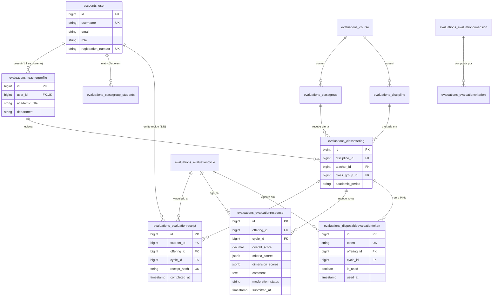
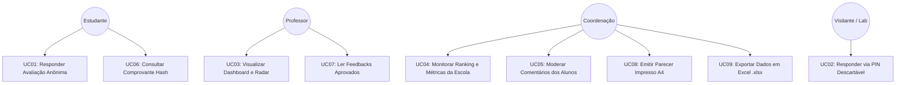

# DOCUMENTAÇÃO TÉCNICA E FUNCIONAL
## SISTEMA AVALIA SENAI -- PLATAFORMA DE AVALIAÇÃO DOCENTE INSTITUCIONAL

---

### IDENTIFICAÇÃO DO PROJETO E EQUIPE

- **Instituição:** Escola SENAI Morvan Figueiredo (São Paulo / SP)
- **Curso:** Desenvolvimento de Sistemas -- Turma: `2025_DEV4_SESI`
- **Professor Orientador:** Johnny Braga de Oliveira
- **Tema:** TEMA-7 -- Sistema de Avaliação de Professores

#### Alunos Integrantes da Equipe:
1. **Eduardo Vieira Roque**
2. **Gustavo Costa Trindade**
3. **Guilherme Vilares**
4. **Aron Maestá**
5. **Diogo Ferrata**

---

## 1. VISÃO GERAL DO PROJETO

### 1.1 Contexto
A Escola SENAI Morvan Figueiredo necessita de um mecanismo confiável, moderno e pedagogicamente fundamentado para que os estudantes possam avaliar o desempenho de seus professores. Os resultados dessas avaliações fornecem insumos estratégicos para a coordenação pedagógica identificar pontos de excelência, detectar necessidades de capacitação continuada e planejar intervenções didáticas construtivas.

### 1.2 Problemática e Desafio Central
A principal barreira em sistemas de avaliação escolar tradicionais reside no receio dos alunos de sofrerem represálias em suas notas ou no tratamento em sala de aula caso expressem críticas sinceras. Se o sistema vincular a identidade do estudante à nota ou comentário, a fidelidade dos dados é corrompida pelo medo. Por outro lado, se a avaliação for completamente desprovida de controle, um único aluno poderia enviar dezenas de avaliações para prejudicar deliberadamente um professor.

### 1.3 Solução Implementada: Protocolo de Anonimato Desacoplado (Zero-Link Anonymity)
O **Avalia SENAI** resolve essa dualidade separando fisicamente e logicamente o controle de presença/voto do conteúdo avaliativo:
1. **Tabela de Recibos (`EvaluationReceipt`):** Registra que o aluno votou naquela disciplina/ciclo e emite um hash criptográfico SHA-256 de comprovação, sem jamais registrar quais notas ou comentários ele enviou.
2. **Tabela de Respostas (`EvaluationResponse`):** Registra as notas e opiniões de forma anônima, sem armazenar matrícula, chave estrangeira do aluno, endereço IP ou dados de dispositivo.
3. **Modo PIN Descartável (`DisposableEvaluationToken`):** Permite a aplicação coletiva em laboratório onde o aluno acessa o formulário diretamente via código de uso único, sem efetuar login.

---

## 2. REQUISITOS DO SISTEMA

### 2.1 Requisitos Funcionais (RF)

| ID | Nome do Requisito | Descrição Detalhada |
|---|---|---|
| **RF-01** | Autenticação por Perfil | O sistema deve autenticar usuários e direcioná-los conforme seu papel: Aluno (`STUDENT`), Professor (`TEACHER`), Coordenação (`COORDINATOR`) e Administrador (`ADMIN`). |
| **RF-02** | Consulta de Avaliações Pendentes | O estudante autenticado deve visualizar a lista de professores e disciplinas em que está matriculado no ciclo vigente, com status (Pendente ou Concluído). |
| **RF-03** | Formulário de Avaliação Estruturado | O sistema deve apresentar questionário organizado por 5 dimensões pedagógicas em escala Likert de 1 a 5 pontos com descritores de qualidade. |
| **RF-04** | Registro de Comentário Opcional | O sistema deve permitir que o estudante adicione observações qualitativas e sugestões construtivas. |
| **RF-05** | Garantia de Voto Único | O sistema deve impedir que o mesmo estudante responda mais de uma vez para a mesma oferta de disciplina em um mesmo ciclo. |
| **RF-06** | Emissão de Comprovante Criptográfico | Ao concluir a avaliação, o estudante deve receber um comprovante digital contendo token hash SHA-256 e data/hora para atestar sua participação acadêmica. |
| **RF-07** | Votação Anônima Direta por PIN | O sistema deve permitir a validação de tokens descartáveis gerados pela coordenação para avaliação sem necessidade de login. |
| **RF-08** | Fila de Moderação Pedagógica | A coordenação deve dispor de interface para revisar comentários de texto livre antes de liberá-los ao docente, podendo aprovar ou rejeitar por violação de conduta. |
| **RF-09** | Dashboard Pessoal do Docente | O professor deve visualizar métricas agregadas de suas turmas: média geral, radar de competências didáticas, histograma de notas e feedbacks aprovados. |
| **RF-10** | Painel Geral da Coordenação | A coordenação deve acessar visão macro com ranking de docentes, média geral da escola, taxa de adesão e gráfico comparativo. |
| **RF-11** | Detalhamento por Dimensão | O sistema deve calcular médias e percentuais de aproveitamento para cada dimensão pedagógica avaliada. |
| **RF-12** | Emissão de Relatório Oficial Impresso | O sistema deve gerar documento institucional formatado para papel A4 com layout oficial SENAI para arquivamento e conselho de classe. |
| **RF-13** | Exportação de Planilha Excel (.xlsx) | A coordenação deve poder exportar arquivo Excel com abas de Resumo Geral, Quadro de Docentes e Comentários Moderados. |
| **RF-14** | Gerenciamento de Ciclos | Administradores devem poder cadastrar e delimitar períodos letivos e datas de vigência das avaliações. |
| **RF-15** | Comutador Rápido de Demonstração | O sistema deve disponibilizar barra superior de demonstração para alternar instantaneamente entre perfis durante bancas e apresentações. |

### 2.2 Requisitos Não-Funcionais (RNF)

| ID | Nome | Descrição |
|---|---|---|
| **RNF-01** | Sigilo e Irreversibilidade | A estrutura do banco de dados deve impossibilitar qualquer correlação técnica entre o registro do estudante e a resposta submetida. |
| **RNF-02** | Compatibilidade de Banco de Dados | O sistema deve operar nativamente tanto no PostgreSQL em nuvem (Supabase) quanto no SQLite local para contingência offline. |
| **RNF-03** | Design System Manrope | A interface deve seguir rigorosamente as especificações do `DESIGN.md`: tipografia Manrope, cores off-black/clean surfaces, botões 8px e ícones SVG profissionais. |
| **RNF-04** | Responsividade | Todas as páginas devem ser responsivas e utilizáveis em smartphones, tablets e computadores de laboratório (grid com colapso em < 768px). |
| **RNF-05** | Performance de Renderização | O tempo de carregamento das páginas não deve exceder 1,5 segundos em conexões padrão escolares. |
| **RNF-06** | Integridade Transacional | As operações de gravação de recibo e resposta devem ocorrer em transação atômica (`transaction.atomic`). |
| **RNF-07** | Acessibilidade e Semântica | Código HTML5 com tags semânticas, rótulos explícitos em formulários e contraste adequado conforme WCAG 2.1 AA. |
| **RNF-08** | Visualização Dinâmica | Os gráficos de radar e barras devem ser renderizados via Chart.js de forma assíncrona e adaptativa. |
| **RNF-09** | Localização Brasileira | Sistema parametrizado para o idioma Português do Brasil (`pt-br`), fuso horário de São Paulo e separadores numéricos adequados. |
| **RNF-10** | Segurança e Higienização | Proteção nativa contra Cross-Site Scripting (XSS), Cross-Site Request Forgery (CSRF) e injeção de SQL via ORM Django. |

---

## 3. ARQUITETURA DO BANCO DE DADOS E DER

### 3.1 Diagrama Entidade-Relacionamento (DER em Mermaid)



> [!IMPORTANT]
> **Observação de Arquitetura Crítica:** Note no diagrama acima que **NÃO EXISTE** nenhuma chave estrangeira, referência ou relacionamento entre `evaluations_evaluationreceipt` e `evaluations_evaluationresponse`. Esse desacoplamento físico garante que as avaliações no Supabase sejam estritamente anônimas.

---

## 4. CASOS DE USO DO SISTEMA

### 4.1 Especificação dos Casos de Uso



#### UC01 -- Responder Avaliação Docente com Anonimato Criptográfico
- **Ator Primário:** Estudante autenticado.
- **Pré-condições:** O estudante deve estar matriculado na turma e o ciclo de avaliação deve estar ativo.
- **Fluxo Principal:**
  1. O aluno acessa a tela "Minhas Avaliações".
  2. Seleciona uma disciplina pendente lecionada por um professor (ex: Prof. Johnny Braga de Oliveira).
  3. O sistema renderiza as 5 dimensões pedagógicas com os critérios estruturados.
  4. O aluno marca suas notas de 1 a 5 em cada critério. O sistema atualiza em tempo real a nota média na tela.
  5. O aluno opcionalmente digita um feedback qualitativo construtivo.
  6. O aluno clica em "Confirmar e Enviar Avaliação Anônima".
  7. O sistema abre transação atômica:
     - Gera o hash SHA-256 e grava o recibo em `EvaluationReceipt`.
     - Grava a resposta sem identidade em `EvaluationResponse`.
  8. O sistema exibe o comprovante digital oficial com o hash de autenticidade.

#### UC02 -- Responder via PIN Descartável (Sessão Coletiva de Laboratório)
- **Ator Primário:** Aluno na bancada do laboratório de informática.
- **Pré-condições:** O aluno possui um código PIN (ex: `SENAI-2025-DEV4-LAB1`).
- **Fluxo Principal:**
  1. O aluno abre a página de Votação por PIN sem efetuar login.
  2. Digita o PIN descartável.
  3. O sistema valida se o PIN existe e ainda não foi consumido.
  4. O sistema exibe o questionário da disciplina associada ao PIN.
  5. O aluno responde aos critérios e submete.
  6. O sistema queima o PIN (`is_used = True`) e salva as notas anonimizadas.

#### UC03 -- Visualizar Dashboard e Radar de Competências (Docente)
- **Ator Primário:** Professor autenticado.
- **Fluxo Principal:**
  1. O docente faz login com suas credenciais ou RF.
  2. O sistema exibe seus KPIs: Média geral, total de avaliações recebidas, dimensão mais forte e oportunidade de aprimoramento.
  3. O sistema renderiza o Radar Chart comparando as 5 dimensões pedagógicas.
  4. O sistema renderiza o Histograma de notas recebidas (1 a 5 estrelas).
  5. O docente lê os comentários qualitativos que já foram deferidos pela moderação.

#### UC04 -- Monitorar Painel e Ranking Geral da Escola (Coordenação)
- **Ator Primário:** Coordenador Pedagógico ou Administrador.
- **Fluxo Principal:**
  1. A coordenação acessa o Painel Geral.
  2. Visualiza a média consolidada de satisfação de toda a escola.
  3. Analisa o ranking comparativo de todos os docentes lecionando nas turmas.
  4. Acessa atalhos para moderação, relatórios em PDF e download de planilhas.

#### UC05 -- Moderar Feedbacks Qualitativos
- **Ator Primário:** Coordenação Pedagógica.
- **Fluxo Principal:**
  1. A coordenação visualiza a fila de comentários com status `PENDING`.
  2. Analisa o teor do comentário para verificar se atende ao regulamento de convivência do SENAI.
  3. Clica em "Aprovar" (liberando a exibição no painel do professor) ou "Rejeitar" (inserindo justificativa institucional).

---

## 5. GUIA DO USUÁRIO FINAL

### 5.1 Para o Estudante
1. Acesse o sistema e selecione **"Entrar com Matrícula"** (ou use o atalho de demonstração para Aluno Eduardo).
2. Na página principal do aluno, você verá todas as disciplinas do semestre da sua turma (`2025_DEV4_SESI`).
3. Clique em **"Avaliar Docente"** na matéria desejada.
4. Preencha com sinceridade as notas de 1 a 5 estrelas para cada questão pedagógica.
5. Deixe sugestões no campo de comentário caso deseje.
6. Clique em **"Confirmar e Enviar"**.
7. Guarde o código de hash do seu comprovante digital para apresentar como comprovação de horas complementares ou presença escolar.

### 5.2 Para o Docente (Professor Johnny Braga de Oliveira e Colegas)
1. Faça login com seu Registro Funcional ou selecione o atalho do Prof. Johnny.
2. Seu painel exibirá imediatamente o índice consolidado de satisfação pedagógica das suas aulas.
3. Analise o gráfico de **Radar de Dimensões** para identificar qual área (Didática, Prática de Laboratório, Pontualidade ou Feedback) teve maior destaque.
4. Role até o rodapé para ler os comentários aprovados dos alunos com sugestões para suas aulas.

### 5.3 Para a Coordenação Pedagógica
1. Acesse com o perfil de Coordenação (Profa. Valéria).
2. Verifique a quantidade de alunos que já responderam e a média comparada dos professores.
3. Clique em **"Moderação de Feedbacks"** para autorizar ou recusar comentários com linguagem imprópria.
4. Clique em **"Exportar Excel (.xlsx)"** para extrair os dados tabulados para o conselho pedagógico.
5. Acesse **"Relatórios"** e clique em **"Emitir Relatório"** para imprimir o parecer com campos para assinatura física.

---

## 6. INSTRUÇÕES DE EXECUÇÃO LOCAL E VERIFICAÇÃO

```powershell
# 1. Ativar o ambiente virtual
.\.venv\Scripts\Activate.ps1

# 2. Executar migrações do banco de dados (SQLite ou Supabase via .env)
.\.venv\Scripts\python manage.py migrate

# 3. Carregar dados de demonstração da Escola SENAI Morvan Figueiredo
.\.venv\Scripts\python manage.py seed_data

# 4. Executar os testes automatizados
.\.venv\Scripts\python manage.py test apps.evaluations.tests apps.dashboards.tests

# 5. Iniciar o servidor web
.\.venv\Scripts\python manage.py runserver
```

Acesse: `http://127.0.0.1:8000/` no navegador.
